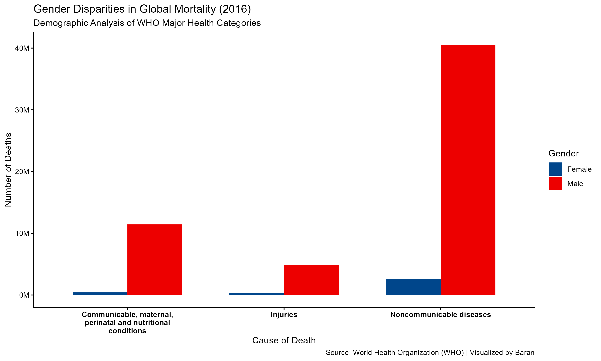

# Gender Disparities in Global Mortality Analysis (2016)

This repository contains an academic data visualization project analyzing gender disparities in global mortality based on official data from the **World Health Organization (WHO)**.

The analysis and visualizations are implemented using **R** and formatted strictly according to the design and publication guidelines of **The Lancet** journal.

## Data Visualization
The final plot utilizes the official Lancet color palette (`scale_fill_lancet`) and features standardized publication-grade text wrapping and axis number formatting:

## Tools & Packages Used
- **R Programming Language**
- `tidyverse` (for data cleaning and reshaping)
- `ggplot2` (for high-quality data visualization)
- `ggsci` (for official journal color palettes)
- `scales` (for professional axis number formatting)

## Scientific Interpretation & Epidemiological Analysis

The generated visualization reveals profound gender disparities in global mortality across the three macro-categories defined by the World Health Organization (WHO) for the year 2016. The epidemiological insights from this data are detailed below:

### 1. Noncommunicable Diseases (NCDs)
- **Observation:** NCDs (such as cardiovascular diseases, cancers, and chronic respiratory conditions) constitute the absolute leading cause of global mortality for both sexes. However, male deaths significantly surpass female deaths by several million.
- **Epidemiological Context:** This stark contrast aligns with global health literature. Historically, males experience higher age-standardized mortality rates from NCDs, driven by a higher prevalence of behavioral risk factors in 2016, including tobacco use, alcohol consumption, and occupational stress.

### 2. Communicable, Maternal, Perinatal, and Nutritional Conditions
- **Observation:** While mortality from infectious and communicable diseases is lower than NCDs globally, a noticeable gender gap persists, with higher absolute deaths recorded in males.
- **Epidemiological Context:** This finding highlights biological and socioeconomic disparities in infectious disease vulnerability and healthcare-seeking behavior, where males often face delayed diagnoses or higher biological susceptibility to certain pathogens.

### 3. Injuries
- **Observation:** The relative difference between sexes is most pronounced in the Injuries category. Male mortality eclipses female mortality by a massive margin.
- **Epidemiological Context:** This is a classic epidemiological pattern observed worldwide. Males are disproportionately exposed to external causes of death due to occupational hazards (heavy industries, construction), higher rates of road traffic accidents, and risk-taking behaviors.

### Conclusion for Health Policy
This analysis demonstrates that global mortality in 2016 was not gender-neutral. Understanding these structural disparities is critical for developing gender-responsive public health interventions and allocating healthcare resources effectively to mitigate preventable premature deaths.
